<div align="center">

# gentoo-install

**A menu-driven installer for [Gentoo Linux](https://www.gentoo.org).**
The Handbook install, done for you: a checked stage3, prebuilt packages or
everything compiled for your CPU (you pick how many cores it uses), OpenRC or
systemd, encryption, Secure Boot, btrfs or ZFS, desktops and dotfiles.

[](LICENSE)


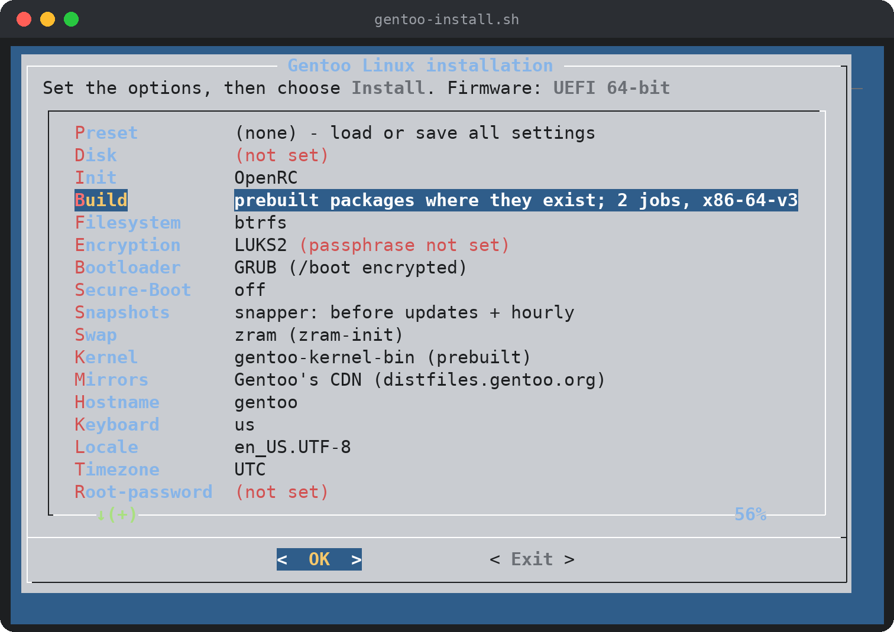

</div>

> [!WARNING]
> **The disk you select is erased completely.** There is no dual-boot mode.

> [!NOTE]
> Version 1.0 is new. It was checked with a simulated install only, **not yet
> on real hardware**. Gentoo's dependency resolver decides things at install
> time that no simulation covers, so try it in a virtual machine first.

## Quick start

Boot the [Gentoo minimal installation ISO](https://www.gentoo.org/downloads/)
(amd64), get online (`net-setup` for Wi-Fi), then as root:

```sh
curl -LO https://raw.githubusercontent.com/aranmi-git/gentoo-install/main/gentoo-install.sh
bash gentoo-install.sh
```

Set the options, choose **Install**. Only the disk, root password, a user and
(if you encrypt) a passphrase are required; everything else has a default that
suits the computer it runs on. Or start from a preset:

```sh
bash gentoo-install.sh --preset kde-openrc
```

## Build settings: you choose how hard your CPU works

<div align="center">
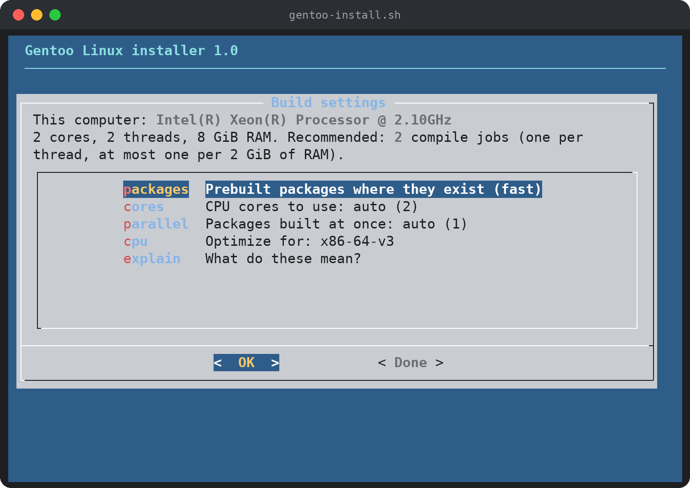
</div>

The **Build** item shows your CPU, its cores and threads and your RAM, and
recommends a number of compile jobs: one per thread, at most one per 2 GiB of
RAM (a C++ compile job can need that much). Then:

| Setting | Choices | Written to |
|---|---|---|
| **Packages** | prebuilt where they exist (fast), or compile everything | `EMERGE_DEFAULT_OPTS="--getbinpkg"`, `FEATURES` |
| **CPU cores** | `auto` or any number | `MAKEOPTS="-jN -lN"` |
| **Packages at once** | `auto` or any number | `--jobs=N` |
| **Optimize for** | x86-64 (any PC), x86-64-v3 (if your CPU can), or this exact CPU | `-march=...` |

Prebuilt packages come from Gentoo's binary host with their signatures checked
(`getuto`, `binpkg-request-signature`); with x86-64-v3 the installer switches
to Gentoo's v3 package set. A package whose USE flags differ is compiled
anyway. The CPU's instruction-set flags (`CPU_FLAGS_X86`) are filled in by
`cpuid2cpuflags`. Everything stays editable later in `/etc/portage/make.conf`,
which explains each line.

<table>
<tr>
<td width="50%">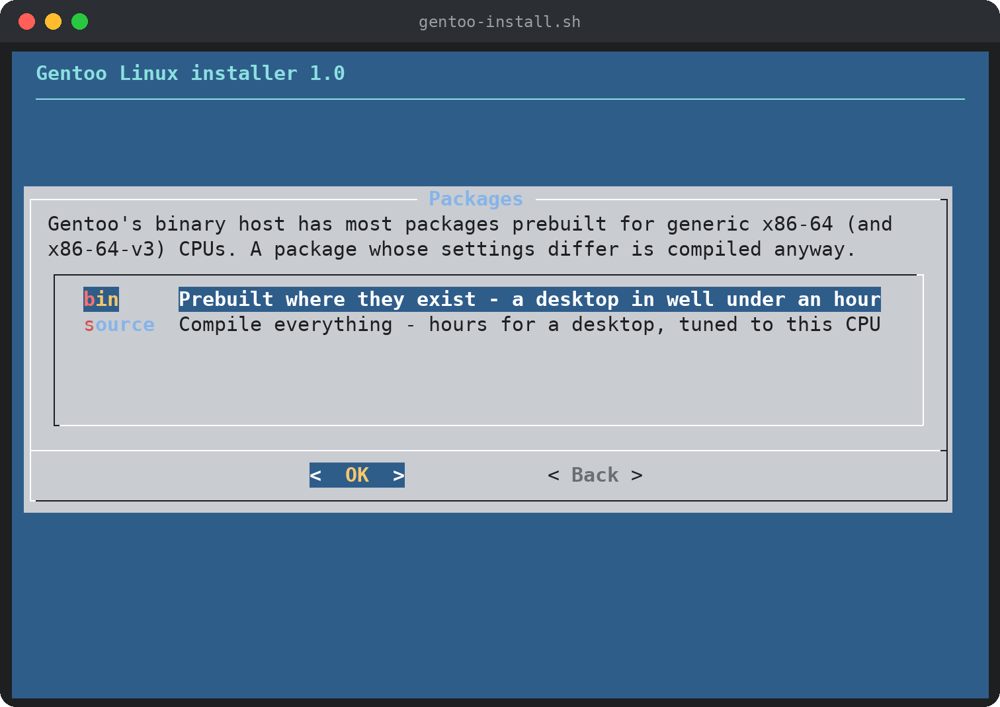<br><sub><b>Packages:</b> prebuilt where they exist, or compile everything</sub></td>
<td width="50%">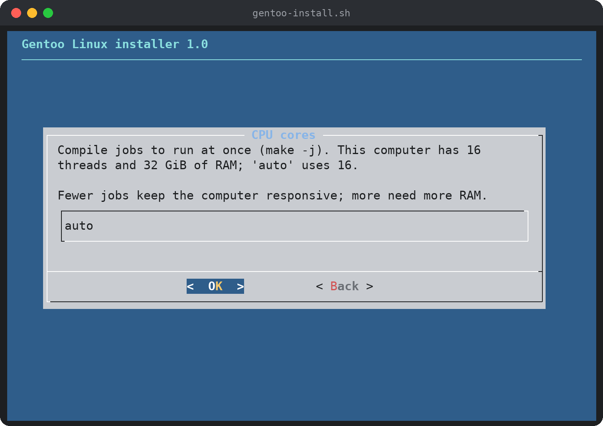<br><sub><b>CPU cores:</b> <code>auto</code> or a number; more threads than you have is allowed, with a warning</sub></td>
</tr>
<tr>
<td>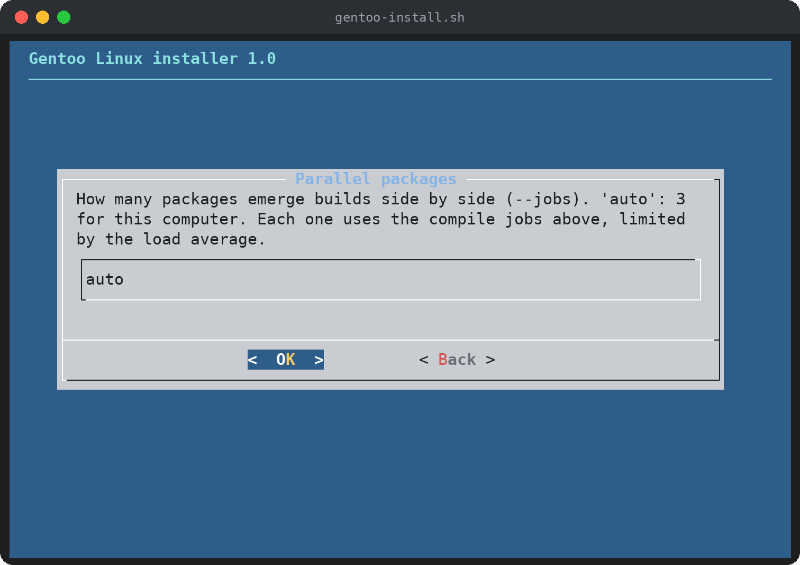<br><sub><b>Packages at once:</b> emerge <code>--jobs</code>, held back by the load average</sub></td>
<td>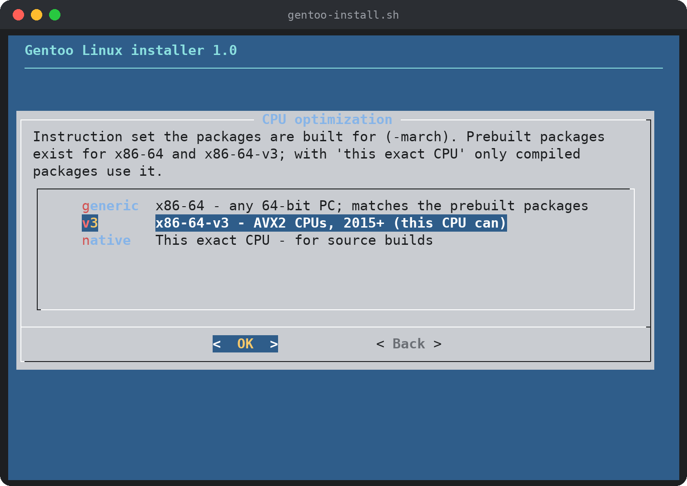<br><sub><b>Optimize for:</b> x86-64-v3 is offered only if the CPU can run it</sub></td>
</tr>
<tr>
<td>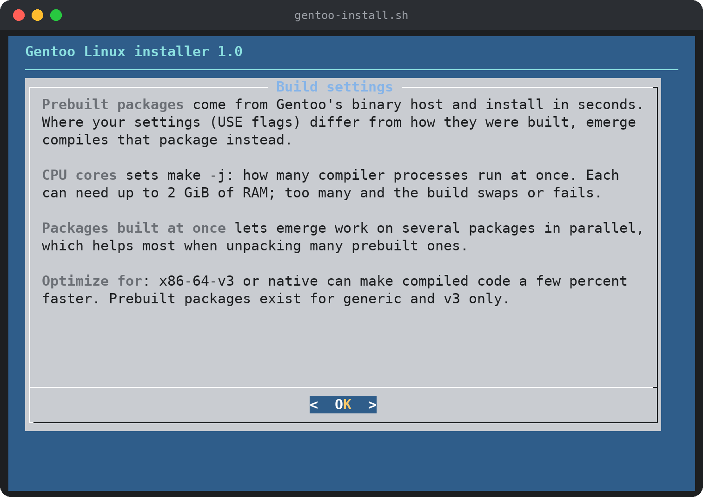<br><sub><b>What do these mean?</b> Each setting in plain words</sub></td>
<td>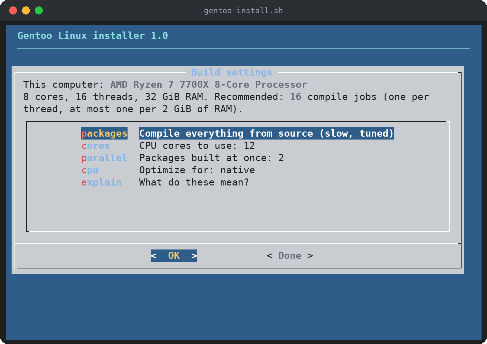<br><sub>Set up for compiling: 12 cores, 2 packages at once, this exact CPU</sub></td>
</tr>
</table>

### What it writes to /etc/portage

Here is what a KDE Plasma + Hyprland install writes on a Ryzen 7 7700X (16
threads, 32 GiB, AMD graphics, Secure Boot, prebuilt x86-64-v3 packages):

<div align="center">
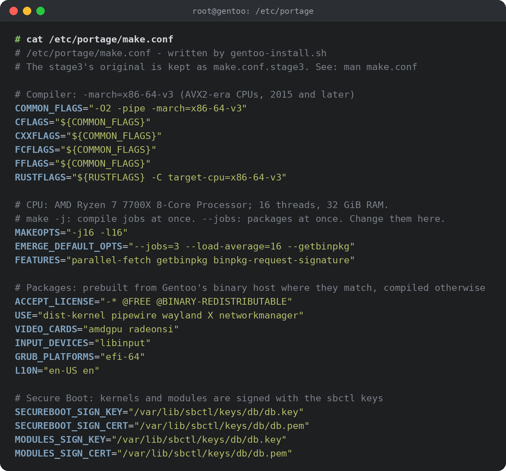
</div>

USE flags for single packages, the CPU's instruction-set flags, testing
keywords for the overlay only, and Gentoo's binary host switched to the v3
package set:

<div align="center">
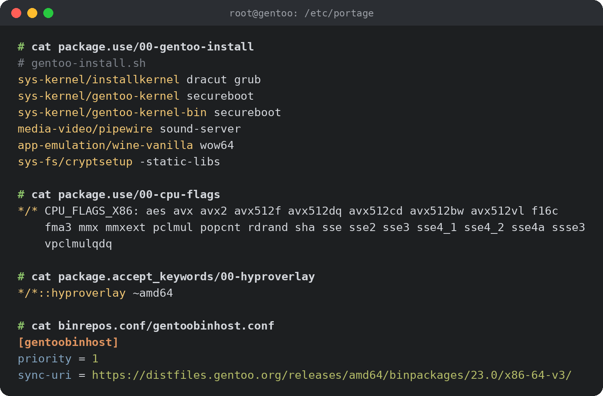
</div>

Changes that emerge needs later (autounmask) go to files of their own in
the same folders, so the installer's files stay as shown.

## How it installs

1. Downloads the newest **stage3** for your choice (OpenRC or systemd, desktop
   or not) and checks its signature against Gentoo's release key
   (fingerprint `13EBBDBEDE7A12775DFDB1BABB572E0E2D182910`); an unsigned or
   changed tarball is refused.
2. Writes `make.conf`, gets the repository with `emerge-webrsync` (signed),
   picks the matching **profile** (`desktop/plasma`, `desktop/gnome/systemd`,
   ...), and updates `@world`.
3. Installs Gentoo's **distribution kernel** (`gentoo-kernel-bin`, or
   `gentoo-kernel` compiled here) with **installkernel** and **dracut**, so
   every kernel update lands in the boot loader by itself.
4. Desktop, applications, services, boot loader, checks.

Emerge runs unattended: USE, keyword and licence changes a package needs are
accepted and written to `/etc/portage` (autounmask). Licences start from
`@FREE @BINARY-REDISTRIBUTABLE`.

## What it can do

| | |
|---|---|
| **Init** | OpenRC or systemd |
| **Firmware** | UEFI (64-bit or 32-bit) and legacy BIOS, on GPT |
| **Filesystem** | ext4, btrfs with subvolumes, or **ZFS** (Gentoo's own sys-fs/zfs) |
| **Encryption** | none, LUKS1 or LUKS2 (dracut `crypt`, `/etc/crypttab`) |
| **Boot loader** | GRUB, systemd-boot, unified kernel images (UKI), ZFSBootMenu |
| **Secure Boot** | your own keys with sbctl; the distribution kernel signs itself and its modules (`USE=secureboot`) |
| **Snapshots** | snapper (btrfs) or ZFS; one before every `update-system`, plus hourly with snapper |
| **Kernel** | gentoo-kernel-bin (prebuilt) or gentoo-kernel (compiled) |
| **Network** | NetworkManager, dhcpcd + iwd, or systemd-networkd |
| **Desktops** | KDE Plasma, GNOME, Xfce, Cinnamon, MATE, LXQt, Enlightenment |
| **Window managers** | Hyprland (hyproverlay), Sway, niri and river (GURU), labwc, Wayfire, i3, bspwm, dwm, awesome, Qtile, herbstluftwm, Openbox, Fluxbox, IceWM, spectrwm, LeftWM |
| **Login screen** | SDDM, GDM, LightDM, greetd + tuigreet, Ly (GURU) |
| **Dotfiles** | 21 presets: CachyOS, EndeavourOS, Garuda, LARBS, gh0stzk, Chris Titus |
| **Also** | GPU drivers (VIDEO_CARDS set for you), apps (Firefox, LibreOffice and Thunderbird as prebuilt `-bin` with prebuilt packages), Steam (Flatpak), Wine, peripherals, users with sudo levels, LARBS-style bootstrap, presets |

### Overlays

Packages outside Gentoo's own repository come from **GURU** (community
overlay; turn it on in **Overlays**, and it turns on by itself for Ly, niri,
river, LeftWM and some peripheral tools) and **hyproverlay** (Hyprland, which
left Gentoo's repository in 2026). Testing keywords are accepted for those
repositories only, and the installer tells you before it enables them.

<div align="center">
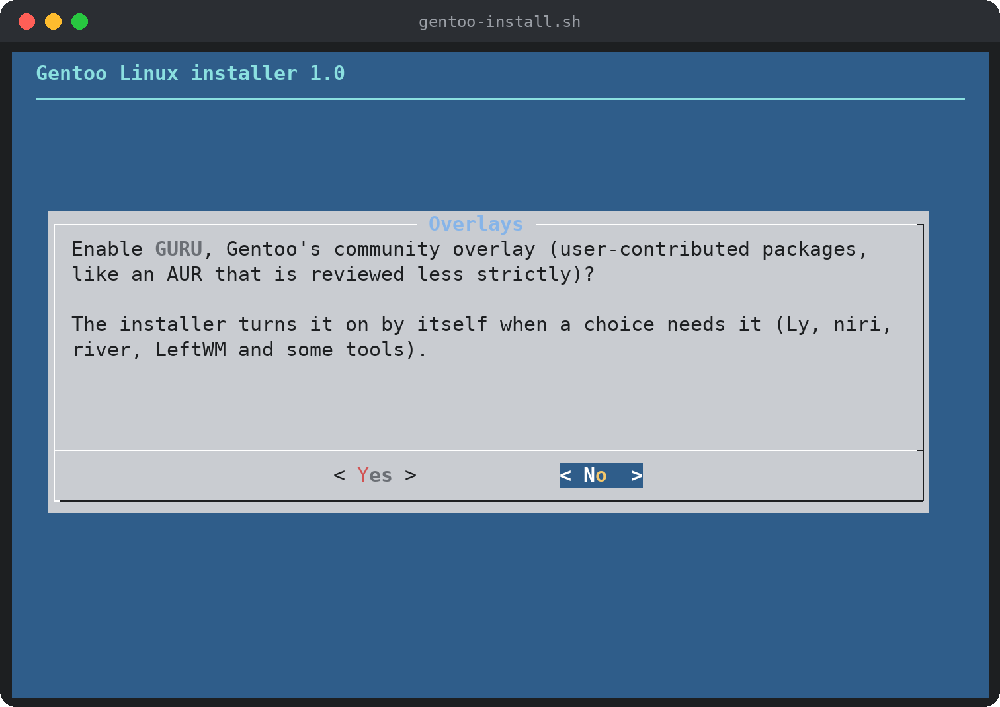
</div>

## Keeping it up to date

```sh
sudo update-system        # snapshot, emerge --sync, update @world, depclean
sudo update-system -y     # the same without questions
```

## ZFS

Choose **zfs** (64-bit UEFI, and a live system with ZFS tools, such as
Gentoo's LiveGUI ISO). Pool `zroot` on the root partition or on LUKS2;
`zroot/ROOT/gentoo` holds `/` and `/boot`, and `home`, `var/log`,
`var/cache/distfiles` and `var/cache/binpkgs` are separate. The module
rebuilds with every kernel (`dist-kernel`). ZFSBootMenu 3.1.0 is built on the
new system with dracut's `crypt` module (its release images cannot unlock
LUKS); its image on the EFI partition is checked to hold no key.

## Presets

| Name | ID | What it installs |
|---|---|---|
| `server-openrc` | `server-openrc@851f4f98cf5c7932` | OpenRC server: dhcpcd, SSH |
| `kde-openrc` | `kde-openrc@024bca8632ae482d` | OpenRC, KDE Plasma, btrfs + snapshots |
| `gnome-systemd-uki` | `gnome-systemd-uki@dda37345d1cc5265` | systemd, GNOME, unified kernel images, Secure Boot |
| `hyprland-systemd` | `hyprland-systemd@2215f32ac0a64c1e` | systemd, systemd-boot, Hyprland with CachyOS's settings |
| `i3-openrc-source` | `i3-openrc-source@cde2618df0ecf61b` | OpenRC, i3, everything compiled for this CPU |
| `zfs-plasma-openrc` | `zfs-plasma-openrc@c1c4d7892796d203` | OpenRC, KDE on ZFS, ZFSBootMenu, ZFS snapshots |

All use LUKS2 and `auto` CPU cores, so they fit any computer. A preset never
holds passwords.

## License

[GNU General Public License, version 2](LICENSE). No warranty. Dotfile presets
and overlay packages are downloaded at install time and stay under their
authors' licenses.
